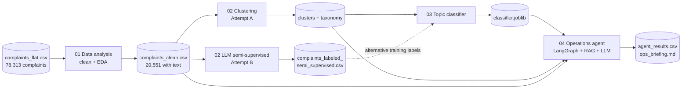
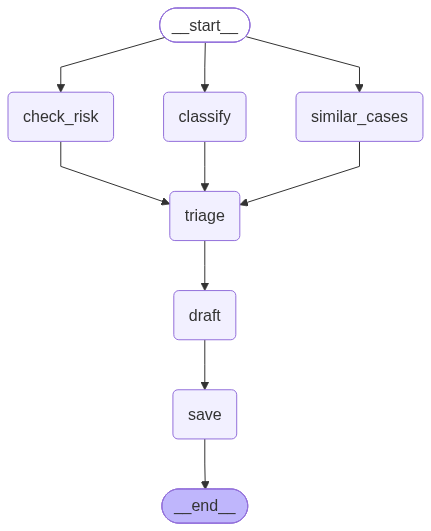

# Customer Complaints: Topic Discovery and an Operations Agent

## Project description

A bank receives thousands of customer complaints. Each one arrives with some metadata (product, the issue the customer picked from a drop-down, date, tags such as *Older American*) and, in about a quarter of cases, a free-text story written by the customer. The operations team has to read these stories, work out what each complaint is really about, send it to the right team, spot the urgent ones and reply. Today that is manual work, and the drop-down `issue` field is too vague to route on ("Managing an account" is the most common value).

This project builds an end-to-end AI solution for that team:

1. **Understand the data.** Explore 78k complaints, document the data-quality problems and keep the 20,551 complaints that have a usable narrative.
2. **Find what customers actually complain about.** Discover topics from the complaint text and turn them into a short taxonomy the team can route on. Two approaches were tried:
   - **Attempt A, clustering:** text features and embeddings, K-Means, LLM-named clusters merged into topics. *This attempt feeds the classifier and the agent.*
   - **Attempt B, LLM semi-supervised labelling:** an LLM labels a 10% sample and builds its own label set, a classifier labels the rest, and uncertain cases go back to the LLM.
3. **Classify new complaints** with a supervised model, so the topics can be assigned instantly without re-running the clustering.
4. **Act on each complaint** with an LLM-powered operations agent (LangGraph). It classifies the complaint, retrieves similar past cases (RAG), checks the risk, routes it to a team, drafts an internal note and a customer reply, and writes a weekly briefing for the operations lead.

The guiding principles are the ones that matter for a regulated operations team. **Outputs are grounded** in the model and the data, **uncertainty is measured** rather than guessed, and **a person stays in control**: uncertain topics pause for a reviewer, risky cases are escalated with a reason, and no reply is ever sent automatically.

The data is the public CFPB consumer complaint database, filtered to one bank (JPMorgan Chase).

---

## Pipeline at a glance



---

## Repository structure

```
.
├── notebooks/
│   ├── 01_data_analysis.ipynb                  # gather, assess, clean, EDA
│   ├── 02_clustering.ipynb                     # Attempt A: TF-IDF + embeddings, clustering, taxonomy
│   ├── 02_llm_semi_supervised_labeling.ipynb   # Attempt B: LLM labels a sample, classifier + LLM label the rest
│   ├── 03_topic_classifier.ipynb               # supervised model on the clustering topics
│   └── 04_operation_agent.ipynb                # LangGraph agent + weekly operations briefing
├── data/
│   ├── raw/complaints_flat.csv                 # input data
│   ├── clean/                                  # output of 01
│   ├── interim/                                # outputs of the two 02 notebooks
│   └── output/                                 # outputs of 04
├── models/                                     # trained classifier and Chroma vector store
├── docs/                                       # images used in this README
├── requirements.txt
└── .env                                        # API credentials (never commit real keys)
```

---

## Setup

You need **Python 3.13**.

```bash
python -m pip install -r requirements.txt
```

Create a `.env` file in the project root. The notebooks that call an LLM (`gpt-4o-mini`) read it:

```
OPENAI_API_KEY=your-key
OPENAI_BASE_URL=https://api.openai.com/v1
```

Put the raw data at `data/raw/complaints_flat.csv`. Every notebook creates its output folders itself.

The embedding model (`minishlab/potion-base-2M`) is downloaded from Hugging Face on first use. It is a tiny static model (64 dimensions), so everything runs on a laptop CPU.

---

## How to run

Run the notebooks in this order. Each one reads what the previous one saved.

| # | Notebook | Reads | Writes | LLM cost |
|---|----------|-------|--------|----------|
| 1 | `01_data_analysis` | `data/raw/complaints_flat.csv` | `data/clean/complaints_clean.csv` | none |
| 2a | `02_clustering` | `complaints_clean.csv` | `data/interim/`: `embeddings_potion-base-2M.npy`, `complaints_clusters.csv`, `cluster_names.json`, `taxonomy.json`, `cluster_to_topic.json`, `cluster_summary.csv`, `method_comparison.csv` | ~20 calls (cluster names) |
| 2b | `02_llm_semi_supervised_labeling` *(optional, Attempt B)* | `complaints_clean.csv` | `data/interim/`: `complaints_labeled_semi_supervised.csv`, `llm_taxonomy.json`, `llm_review_queue.csv` | ~2k calls for the sample + one per uncertain complaint (about $1 with `gpt-4o-mini`); cached |
| 3 | `03_topic_classifier` | `complaints_clean.csv`, `complaints_clusters.csv` | `models/kmeans_cluster_classifier.joblib` | none |
| 4 | `04_operation_agent` | all of the above (from Attempt A) | `models/chroma_db/`, `data/output/agent_results.csv`, `data/output/ops_briefing.md`, `data/output/agent_architecture.png` | 2 calls per complaint + one per complaint in the briefing window (~380) |

**Between steps 2a and 3:** open `data/interim/cluster_names.json` and review the names the LLM gave the clusters. Clusters that share a name become one topic, so this is where the taxonomy is finalised (see below).

**When step 2a is re-run:** re-run 3 and 4 as well, because the cluster ids change.

---

## What each notebook does

### 01 · Data analysis

**Data-quality findings**

| Issue | Impact | Decision |
|---|---|---|
| Only 27% of complaints have a narrative (none before 2015; text needs the customer's consent) | Text models cover 21,072 complaints, not 78k | Model the complaints with text only |
| `company_public_response` is 100% empty, `tags` 86% empty, `sub_issue` 59% empty | No signal, or missing values that mean "none" | Drop, or fill with `none` |
| The same product has two names (`Credit card` / `Credit card or prepaid card`, ...) | Product counts are split | Merge into 10 product groups |
| 246 texts under 15 words, 142 exact duplicates | Too short to classify, or double-counted | Remove: 298 short texts and 223 duplicates after cleaning |
| `XXXX` placeholders (in 85% of texts) and `{$100.00}` amounts | Noise for word-based models | Remove them in `clean_text`; keep the original `text` for reading |
| Only one company, and every complaint with text came through the web | `company` and `submitted_via` carry no information | Not used as features |
| `consumer_disputed` is only known after the case closes | Would leak the outcome | Dropped |

**What the EDA shows** (20,551 complaints, March 2015 to March 2021)
- Credit/prepaid cards (34%), checking/savings (29%) and mortgages (16%) make up about 80% of complaints.
- The customer-chosen `issue` is vague: "Managing an account" is the top value (11%) and "Other features, terms, or problems" is in the top five. This is why topics are taken from the text.
- The median complaint is about 170 words; mortgage complaints are the longest.
- 18% of complaints are tagged *Older American* and/or *Servicemember*.
- 77% are closed with an explanation only and 23% with some relief. Relief depends strongly on the product (about 30% for checking/savings, 6% for mortgages) and grew from 13% in 2015 to 26% in 2019.

### 02 · Attempt A: clustering and taxonomy (`02_clustering`)

1. **Two views of every complaint.**
   - **TF-IDF** (words and word pairs, compressed to 200 dimensions with SVD) captures the vocabulary.
   - **Embeddings** from `minishlab/potion-base-2M` capture meaning, so different wordings of the same problem land close together.
   - They are combined with a weight `alpha` (0.5 was chosen after comparing 0, 0.25, 0.5, 0.75 and 1).
2. **UMAP** reduces the combined vectors to 10 dimensions for clustering, plus 2 dimensions for plots.
3. **Four methods compared.** Silhouette is weak for text, so the methods are judged on several signals together: agreement with the customer's `issue` (NMI), topic coherence, cluster sizes, unassigned share, agreement between methods (ARI), seed stability, and reading examples.

   | Method | Clusters | Unassigned | Largest | NMI with issue | Coherence | Silhouette |
   |---|---|---|---|---|---|---|
   | **K-Means** | 20 | 0% | 9.9% | 0.375 | **-72.5** | 0.041 |
   | Agglomerative (Ward) | 20 | 0% | 9.5% | 0.380 | -76.8 | 0.043 |
   | HDBSCAN | 23 | **34%** | 23.1% | 0.435 | -84.4 | 0.069 |
   | NMF (TF-IDF baseline) | 20 | 0% | 11.1% | 0.276 | -85.3 | 0.051 |

   *(These numbers are from the run with the previous embedding model, `all-MiniLM-L6-v2`; they will shift slightly after a re-run with `potion-base-2M`.)*

   **K-Means with 20 clusters** was kept. It has the best coherence, labels every complaint and gives balanced sizes. HDBSCAN leaves a third of complaints unassigned, which an operations team cannot use.
4. **An LLM names each cluster.** It gets the cluster's own top words and 5 example complaints, and returns a name, a one-sentence description and whether the examples look mixed. These are saved to `cluster_names.json`.
5. **From clusters to the taxonomy.** Each cluster's name becomes its topic and its description becomes the topic definition. Clusters that share a name become one topic. The taxonomy decision is therefore made in one reviewable file: edit the names in `cluster_names.json` (for example to merge two mortgage clusters, or to drop the bank's name) and re-run section 12. The outputs are `taxonomy.json` and `cluster_to_topic.json`.

The previous run produced 12 operational topics:

| Topic | Share of complaints |
|---|---|
| Mortgage servicing & modification | 16.6% |
| Fraud & unauthorized transactions | 15.6% |
| Account access, holds & restrictions | 14.6% |
| Credit reporting errors & inquiries | 10.0% |
| Card & merchant disputes | 9.8% |
| Card fees, interest & promotions | 7.5% |
| Card closures & limit changes | 5.8% |
| Auto loan & finance | 5.6% |
| Identity theft & fraudulent accounts | 4.2% |
| Overdraft & account fees | 3.6% |
| Payments & late payments | 3.6% |
| Customer service & communication (catch-all) | 3.1% |

Most topics are dominated by one product (for example 82% of mortgage-topic complaints are mortgages), which is what topics describing a real problem should look like. Fraud, credit reporting and customer service span several products. These are cross-product problems that the product field alone would hide.

### 02 · Attempt B: LLM semi-supervised labelling (`02_llm_semi_supervised_labeling`)

A second, independent way to get topic labels. Instead of clustering first, an LLM reads complaints directly and a cheap classifier scales its work up.

1. **The LLM labels a random 10% sample** (about 2,000 complaints). The label list starts empty. For each complaint the LLM either picks an existing label or creates a new, broad one. Complaints are sent in batches of 20, and new labels are added after each batch so later complaints can reuse them.
2. **The label set is cleaned up.** One LLM call merges near-duplicate labels into at most 15 topics. Topics with fewer than 15 complaints are dropped, and their complaints are re-assigned. The result is saved to `llm_taxonomy.json`.
3. **A TF-IDF + logistic regression classifier** is trained on the LLM labels. 5-fold cross-validation measures how well it reproduces the LLM, and picks the **confidence threshold**: the lowest one where accepted predictions agree with the LLM at least 90% of the time.
4. **The classifier labels the other 90%.** Predictions above the threshold are accepted.
5. **Low-confidence predictions go to a review queue** (`llm_review_queue.csv`), and the LLM assigns each one to an existing topic. No new topics are created at this stage.
6. **One output file**, `complaints_labeled_semi_supervised.csv`, holds every complaint with:
   - `topic`
   - `topic_conf`
   - `topic_source`, which says where the label came from: `llm` (the sample), `model` (a confident prediction), `llm_review` (uncertain, labelled by the LLM) or `model_low_conf` (uncertain and not reviewed, only if a call failed or the budget cap was hit)

All LLM answers are cached on disk, so a re-run or a crash never pays twice. The prompts treat the complaint as data, not instructions. The notebook also compares its labels with Attempt A (NMI and a cross-tab).

**Attempt A or Attempt B?**

| | Attempt A: clustering | Attempt B: LLM semi-supervised |
|---|---|---|
| Labels come from | groups of similar complaints | an LLM reading each complaint |
| Cost | ~20 LLM calls | ~2k + review-queue calls (about $1) |
| Strength | cheap, finds structure no one defined | per-complaint labels with clear definitions; handles mixed clusters |
| Weakness | clusters are mixed, so a cluster's topic is not every member's topic | depends on the sample and the LLM; labels are still AI-made |
| Used by | the classifier (03) and the agent (04) | ready as training labels for a better classifier |

Attempt A drives the current pipeline because it is cheaper and fully reproducible. Attempt B's file is the natural next step for training the final classifier. Training on `topic_source` in (`llm`, `llm_review`) avoids teaching a model its own predictions.

### 03 · Topic classifier (`03_topic_classifier`)

The classifier predicts a complaint's K-Means cluster from the complaint itself, so new complaints get a topic instantly.

- **Inputs:** `clean_text`, `tags`, `submitted_via` and `n_words`. Product and issue are deliberately left out. The clusters were built without them, and for a new complaint they are unreliable or missing.
- **One scikit-learn pipeline** holds feature engineering and model together:
  - text → TF-IDF on words and word pairs
  - categories → one-hot
  - length → log, then scaled
- **Model selection:** 5-fold stratified CV on the training set, comparing three models.

  | Model | CV macro F1 |
  |---|---|
  | **Linear SVM** | **0.823** |
  | Logistic regression | 0.783 |
  | Complement Naive Bayes | 0.723 |

- A **grid search** then tunes the best model together with its feature settings.
- The 20% test set is used once, at the end: **accuracy 0.819, macro F1 0.821**. The mistakes are mostly between neighbouring clusters, which overlap themselves.
- The whole pipeline is saved as one joblib file that takes raw columns.

*(These numbers come from the clusters of the previous run; re-run after step 2a.)*

### 04 · Operations agent (`04_operation_agent`)

The agent is a **LangGraph** workflow. The three tools run in parallel, and triage waits for all of them:

<p align="center">
  
</p>

| Step | What it does | How |
|---|---|---|
| **classify** | topic + confidence + top-3 suggestions | the classifier from 03. Cluster scores are turned into 0-1 values (softmax) and summed per topic. **Below the review threshold the graph pauses (`interrupt`) until a person picks the topic.** |
| **similar_cases** | the 5 closest past complaints, with their topic and outcome | **RAG with LangChain + Chroma.** One document per past complaint, with metadata (id, date, topic, product, outcome). The embeddings are `potion-base-2M`, with the same text cleaning as the clustering notebook. |
| **check_risk** | `yes`/`no` + a one-sentence reason | **LLM with structured output.** Criteria in the prompt: fraud, account takeover, identity theft, legal threats, serious financial harm, a vulnerable customer being harmed, or text that tries to instruct an AI. The customer's tags are passed in. **If the call fails, the answer is "yes".** |
| **triage** | team, target days, priority, whether a person must look | **Plain rules, no LLM.** The team comes from keyword rules on the topic name (and definition), so routing works whatever the taxonomy is called. High priority = risk "yes". A person reviews the case if the topic was uncertain, the risk is "yes", or the topic has no specific team. |
| **draft** | summary, next step, customer reply | **LLM with structured output.** It gets only the facts above, the retrieved cases and the complaint (marked as untrusted text). |
| **save** | checks the draft and writes `agent_results.csv` | **Plain code.** It flags replies that promise refunds or timelines, and complaint ids that don't appear in the retrieved cases, and adds the case reference if it is missing. A failed check sends the case to a person; it doesn't block it. |

**Measuring uncertainty.** The review threshold is not guessed. The agent rebuilds the classifier's held-out test split and measures, for each threshold, how many complaints the model would label by itself (coverage) and how often it is right (accuracy). It picks the lowest threshold with at least 95% accuracy. On the previous run that was **0.55**: the model decided alone on about three quarters of complaints, and a person picked the topic for the rest (overall topic accuracy on the test set: 86%).

**Weekly operations briefing** (`ops_briefing.md`):
- volume per topic over the last 4 weeks against the 12 weeks before
- the topics rising by 25% or more
- the high-risk complaints to look at first, with the LLM's reason
- how many cases the agent sent to people

**Example output** (a real run, one row of `agent_results.csv`):

> **Complaint:** "I was charged three overdraft fees of $34 on the same day, even though my paycheck was deposited that morning…"
> **Topic:** Overdraft & account fees (model, confidence 0.999) → **Deposit Accounts**, priority Normal, no person needed.
> **Risk:** no. "The complaint does not indicate any fraud, identity theft, or serious financial harm."
> **Similar cases:** 5 retrieved; all 5 were closed with relief.
> **Summary:** "The customer is reporting three overdraft fees of $34 charged on the same day their paycheck was deposited… Similar past cases indicate that customers have experienced issues with overdraft fees related to timing of transactions and deposits."
> **Draft reply (not sent):** "Thank you for reaching out regarding your concern about the overdraft fees on your account. Your case ID is CASE-5F226AB6…"

The notebook demos four paths: a clear case, a vague case that pauses for a reviewer, a high-risk case from an *Older American*, and a complaint that tries to steer the agent (prompt injection). The full architecture, including models, data stores, LLM calls and the reviewer, is drawn by the notebook and saved to `data/output/agent_architecture.png`.

---

## Grounding, uncertainty and human-in-the-loop

| Question | Answer in this project |
|---|---|
| **How are outputs grounded?** | Facts (topic, confidence, similar cases, routing, priority) come from the classifier, the data and fixed rules. The LLM only writes text from those facts and the retrieved cases, and the draft is checked by code against them (no promises, no invented complaint ids). |
| **How is uncertainty handled?** | The topic confidence threshold is calibrated on held-out data (a coverage vs. accuracy dial). Attempt B picks its threshold the same way with cross-validation. A failed risk check counts as risky. Labels keep their source and confidence (`topic_source`, `topic_conf`). |
| **Where is the human in the loop?** | (1) An uncertain topic pauses the graph until a person picks it. (2) A risky, catch-all or failed-check case goes to a person with the reasons. (3) Every customer reply is a draft and is never sent automatically. (4) The taxonomy is finalised by a person in `cluster_names.json`. |
| **Is the LLM safe from the complaint text?** | Every prompt marks the complaint as untrusted data. The risk check flags instruction-like text, and the draft check catches the effect (a promise) even if the writer were fooled. |

---

## Limitations and next steps

**Limitations**
- **No human labels.** Every label comes from AI (clustering plus LLM), so every reported accuracy is agreement with that labelling, not ground truth.
- **Clusters are mixed**, so a cluster's topic is not every member's topic. "Auto loan & finance" was the weakest mapping in the previous run.
- **The embedding model ignores word order.** `potion-base-2M` is very fast but treats "not authorized" and "authorized" alike, which affects clustering and retrieval.
- **The risk check has not been measured** against human decisions.
- **Routing is approximate.** The rules, teams and target days are placeholders to agree with the operations lead.

**Next steps**
1. Have the team label about 200 complaints, to measure the real accuracy of both attempts and of the risk check.
2. Train the final classifier on Attempt B's labels (`topic_source` in `llm`, `llm_review`) and compare it with the cluster-based one on those human labels.
3. Send the agent's drafts through a review screen and log reviewer edits, to improve the prompts.
4. Move the agent from a notebook to a service, with the threshold, routing rules and prompts as configuration.
